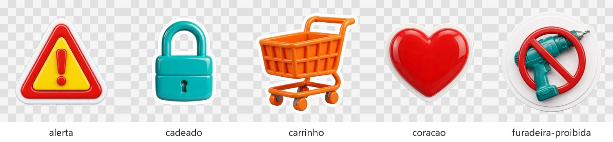

# Biblioteca de figurinhas

Figurinhas 3D **genéricas**, em PNG transparente, para usar como destaque em overlay em qualquer vídeo. Elas valem para todos os níveis: no Nível 1, entram de graça, sem gerar nada.

O repositório traz só um **pacote inicial** (as 5 abaixo), como exemplo da ideia. As figurinhas que você gerar ou copiar para esta pasta ficam **só no seu computador**: o `.gitignore` não as envia ao Git. Monte a sua biblioteca do jeito que quiser.



| arquivo | o que é | quando usar |
|---|---|---|
| `alerta.png` | triângulo de alerta amarelo e vermelho com "!" | perigo, cuidado, erro comum, "atenção" |
| `cadeado.png` | cadeado verde-água fechado | segurança, trava, privacidade, garantia |
| `carrinho.png` | carrinho de compras laranja | CTA de compra, "clica no carrinho", oferta |
| `coracao.png` | coração vermelho | "amei", favorito, recomendação pessoal |
| `furadeira-proibida.png` | furadeira cortada pelo sinal de proibido | "não precisa furar", instalação sem ferramenta |

Esta tabela e o `_catalogo.jpg` descrevem só o pacote inicial. Anote as suas figurinhas em `LOCAL.md`, nesta pasta, que também fica fora do Git.

Estilo comum a todas: ícone 3D brilhante, contorno branco grosso de adesivo, sombra suave, 1600×1600, sem texto.

## Como usar no Remotion

```tsx
import {Figurinha} from '../../_shared/figurinha';

// dentro de uma <Sequence> que começa na palavra-gatilho
<Figurinha nome="carrinho.png" left={570} top={770} tamanho={320} giro={6} quica />
```

O componente entra com mola elástica, balança e flutua de leve e sai encolhendo nos últimos quadros da `Sequence`. Com `quica`, ele pula no lugar, o que é bom para CTA. As regras de sempre continuam valendo: nada sobre o rosto, a legenda ou a marca d'água, e a figurinha só aparece depois que a palavra é dita.

## Como acrescentar figurinhas

1. Só entra aqui o que é **genérico**: nada de produto, marca, pessoa ou texto de um vídeo específico. O que for de um vídeo só fica em `projetos/<NNN. nome>/`.
2. Gere no mesmo estilo. No meta.ai (Nível 2 · Meta AI, [guia 8](../../../guias/8-nivel-2-meta-ai.md)), o PNG já vem transparente:
   > glossy 3D icon sticker of `<objeto>`, thick white die-cut outline, soft drop shadow, vibrant colors, centered, transparent background, 1:1, no text, no letters
3. Se a imagem vier com fundo (o Flow, por exemplo, não entrega transparência), peça fundo cinza liso e recorte com `python tools/recortar_figurinha.py entrada.jpg saida.png`, que deixa a borda suave. Confira a borda: se sobrar magenta ou fundo, limpe antes de salvar.
4. Use nome curto em português, com hífen (`selo-garantia.png`), e anote em `LOCAL.md` o que é e quando usar.
5. Não altere a tabela acima nem o `_catalogo.jpg`: eles são do pacote inicial que vai no repositório.

Origem do pacote inicial: gerado no Meta AI em outubro de 2026.
